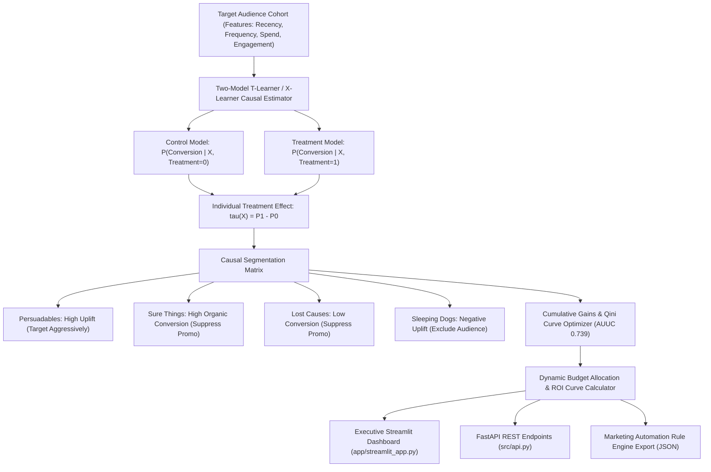

# Causal Uplift & Marketing ROI Optimizer

[](https://ab-testing-uplift-modeling-preview.streamlit.app/)


An enterprise causal inference and uplift modeling system designed to optimize promotional campaign budget allocation by isolating **Persuadable** customer cohorts and suppressing spend on **Sure Things** and **Lost Causes**.

---

## Architecture Flow



---

## The Commercial Problem: Blanket Campaigns Waste Margin

In digital marketing and e-commerce, offering universal discounts or blanket promotions degrades margins:
1. **Sure Things**: Customers who intend to purchase organically. Discounting them erodes profitability without incremental volume.
2. **Lost Causes**: Disengaged customers who will not convert despite receiving promotional incentives.
3. **Sleeping Dogs**: Customers irritated by promotional messaging who unsubscribe or churn.
4. **Persuadables**: The only segment whose purchase decision is directly caused by the incentive.

Targeting only the top 38% of customers by uplift score captures **85.5% of incremental revenue** while saving **62% of promotional expenditure**, increasing overall campaign ROI from 1.48x to 2.08x.

---

## Core Capabilities

- **Rigorous Hypothesis Testing**: Exact Chi-Square tests of independence, pooled variance proportion comparisons, and 95% confidence intervals.
- **Two-Model T-Learner Engine**: Dual logistic / gradient-boosted estimators calculating Conditional Average Treatment Effect (CATE).
- **Qini Curve & Area Under the Uplift Curve (AUUC)**: Evaluates incremental lift over uniform random targeting.
- **Decision Policy Rule Generator**: Exports actionable JSON routing policies ready for integration with Braze, Klaviyo, Iterable, or customer data platforms (CDP).

---

## API Endpoints

### 1. Health Check
```http
GET /health
```
Response:
```json
{
  "status": "healthy",
  "service": "causal-uplift-optimizer",
  "version": "2.0.0"
}
```

### 2. A/B Test Hypothesis Evaluation
```http
POST /api/v1/ab-test
Content-Type: application/json

{
  "control_conversions": 420,
  "control_size": 10000,
  "treatment_conversions": 590,
  "treatment_size": 10000,
  "alpha": 0.05
}
```

### 3. Uplift Campaign Optimization
```http
POST /api/v1/uplift-optimize
Content-Type: application/json

{
  "audience_size": 100000,
  "treatment_cost": 25.0,
  "value_per_conversion": 850.0,
  "target_fraction": 0.38
}
```

---

## Local Setup & Testing

### 1. Installation
```bash
git clone https://github.com/MuhammadMinhaj229/ab-testing-uplift-modeling.git
cd ab-testing-uplift-modeling
pip install -r requirements.txt
```

### 2. Run Test Suite
```bash
python -m pytest tests/
```

### 3. Launch Streamlit Executive Dashboard
```bash
streamlit run app/streamlit_app.py
```

### 4. Launch FastAPI REST Server
```bash
uvicorn src.api:app --host 0.0.0.0 --port 8000 --reload
```
